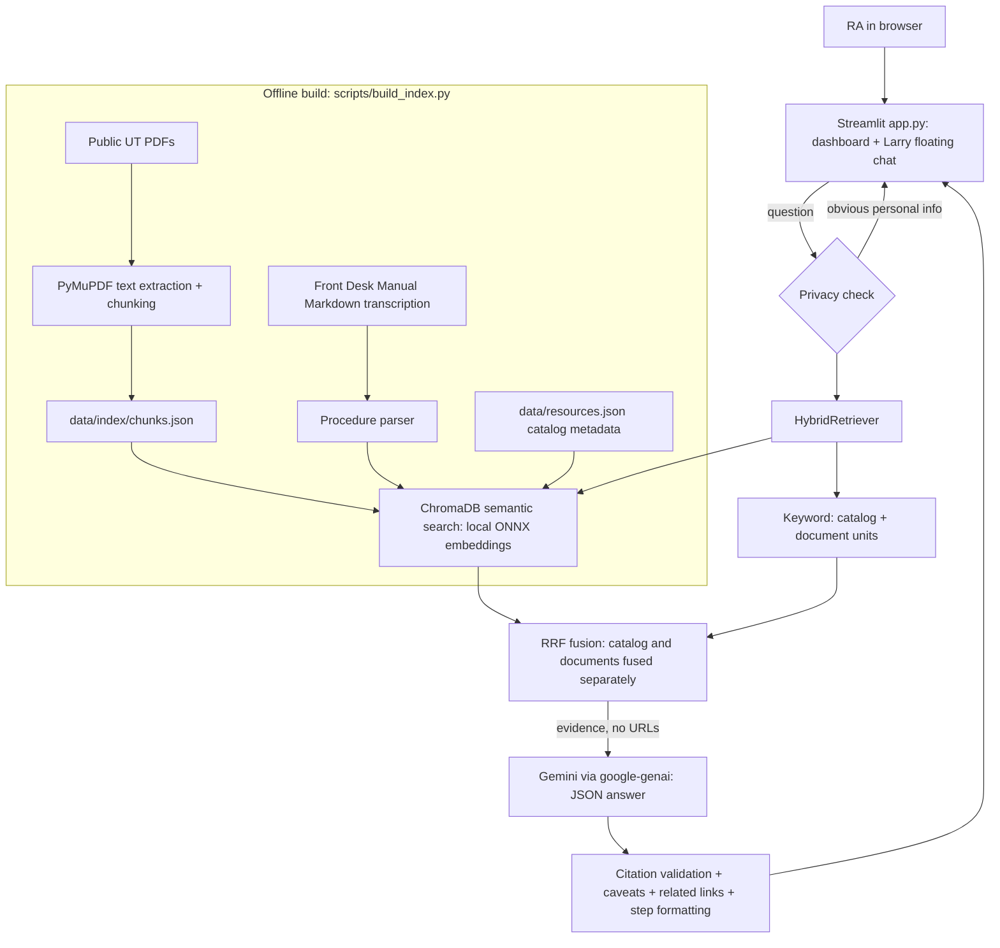

# ResLink AI — Technical Architecture

**Status:** describes the system **as implemented** through Milestone 5 (Staff Bulletin, §8a). The reasons behind each choice are in `docs/DECISIONS.md`; measured quality is
in `docs/EVALUATION.md`.

## 1. Overview



**Data boundary:** the catalog, documents, chunks and vector index stay on the local machine.
Only the user's question and the retrieved evidence (public or approved text, with no URLs) are
sent to Gemini. Questions with obvious personal information are blocked first. The app is
local-first, not fully offline: Gemini needs network access, and the first index build downloads
the embedding model.

## 2. Stack

| Layer | Technology (as built) | Responsibility |
|---|---|---|
| UI | Streamlit 1.67 (`app.py`, `reslink/ui.py`, `reslink/larry.py`, `reslink/static/larry.css`) | Category dashboard, resource cards, sidebar status, Larry floating chat |
| Generation | Gemini through `google-genai` (`reslink/assistant.py`); model from `GEMINI_MODEL` | JSON answer `{sufficient, answer, cited_ids}` from supplied evidence only |
| Keyword retrieval | Pure Python (`reslink/retrieval.py`) | Weighted catalog matching; BM25-style IDF over document units |
| Semantic retrieval | ChromaDB 1.5 persistent collection + built-in ONNX all-MiniLM-L6-v2 (`reslink/semantic.py`) | Nearest catalog entries and chunks; telemetry disabled |
| PDF ingestion | PyMuPDF + requests (`reslink/ingest.py`, `scripts/build_index.py`) | Download catalog PDFs, extract text per page, chunk |
| Procedure ingestion | Standard library (`reslink/procedures.py`) | Parse the Markdown transcription into whole-procedure units |
| Catalog | JSON (`data/resources.json`, validated by `reslink/catalog.py`) | Verified titles, categories, URLs, keywords |
| Privacy | Regex (`reslink/privacy.py`) | Block and redact obvious IDs, emails, phone numbers (not comprehensive) |
| Evaluation | pytest; `scripts/compare_retrieval.py`; `scripts/run_eval.py` | Offline unit/retrieval tests, offline retrieval metrics, budgeted live eval |

Python 3.14. No web framework, database server, authentication or cloud infrastructure.

## 3. Content sources

| Source | Type | How it's used |
|---|---|---|
| Portals (maintenance/Asset Essentials, lockout card access, StarRez roster, Maxient incident form) | `portal` | Catalog metadata and verified links only. **Content is never fetched or indexed.** |
| RA Job Description, University Housing Policies | `pdf` | Downloaded and extracted into page chunks (`data/index/chunks.json`); PDFs kept in `data/documents/` |
| Front Desk Residence Hall Manual | `transcription` | No public URL. Parsed live from `data/procedures/*.md` and its sidecar `*.meta.json` (related catalog IDs, review flags). Not independently verified as current. |

## 4. Request flow (`answer_question` in `reslink/assistant.py`)

1. **Privacy check.** Blank questions, or questions with obvious personal information, stop here.
   No retrieval and no API call; Larry shows a notice and stores a redacted copy in session history.
2. **Follow-up resolution** (no extra API call). Larry passes the last 2 exchanges, excluding
   privacy-blocked turns, as `history`. They're re-sanitized before use: redacted, URLs and
   evidence tags removed, truncated (answers about 600 characters).
   - If the question refers back to something (*it, that, this, there, the form/link/portal…*,
     but not "is there…"), the **retrieval query** is the previous question plus the current one.
   - A question without such words (e.g. "What about quiet hours?") is retrieved on its own, so a
     topic switch doesn't drag in the old topic's evidence.
3. **Retrieval** (`HybridRetriever.retrieve`):
   - **Keyword:** catalog scoring, plus ranked document *units*. A unit is a PDF page or a whole
     procedure section.
   - **Semantic:** Chroma searched separately for catalog metadata (nearest 1, distance ≤ 0.65) and
     document chunks (nearest 8, ≤ 0.75, grouped into at most 1 unit).
   - **Fusion:** reciprocal rank fusion (k = 60), applied to catalog and document results
     separately. Output: up to 3 catalog entries and up to 3 document units.
   - Every hit must resolve to a validated catalog resource, or it's dropped.
4. **No evidence** → insufficient-evidence reply, with no Gemini call.
5. **Gemini** gets the system rules, then (if any) a "Conversation so far" block labeled
   *context only, NOT evidence*, then the evidence blocks, then the question. For follow-ups, the
   question line names the previous question explicitly.
   - Evidence IDs look like `resource-id`, `resource-id@pN` (PDF page) or
     `resource-id#section-slug` (procedure).
   - **Grounding rules:** answer only from evidence; never write URLs; set `sufficient` only for a
     direct answer; never invent steps, fees or fields; keep template placeholders; never request
     personal details; the conversation is never a source.
   - **Format rules:** a direct answer first; numbered steps (one per line) for full
     walkthroughs; a specific answer for a specific question; no source names, page numbers or
     retrieval jargon in the text (the app shows sources).
   - **Domain rules:** paper forms vs online portals (a portal is never "the form"; say where a
     paper form is kept; say when no verified online version exists); for ambiguous procedures
     (lockout key vs access card), answer the likely one and name the other.
6. **Validation by code:**
   - cited IDs must be in the retrieved evidence (others are dropped);
   - no valid citation → the answer is withheld;
   - URLs written by the model are stripped;
   - inline numbered steps are put on separate lines (formatting only);
   - the fire-panel safety guard (below) runs next;
   - step gaps (1 → 4) get a `*Steps 2–3 are missing from the source.*` line with blank lines
     around it, so Markdown keeps the original numbers (answers without gaps are untouched);
   - **partial procedures:** status `partial` (not `grounded`) when a cited unit is INCOMPLETE
     SOURCE **and** the model set `partial` or a step gap was found. Never after the safety
     fallback. The UI shows a fixed amber "Incomplete procedure … check current official
     documentation or ask your headstaff" notice before the steps.

   **Companion fragments:** the sidecar key `companions` links units that are fragments of one
   procedure on different pages (SchoolDude p. 16 ↔ p. 18). Retrieving one adds the other as separate
   evidence, labeled "OTHER FRAGMENT OF THE SAME PROCEDURE". They are never merged.
7. **Response:** answer, citations, and resources (cited ones plus the procedures' related catalog
   resources). Typed `Note`s are added by code:
   - `unverified` (transcription not verified as current) and `unverified_link` (an unverified web
     address is mentioned) render as compact notes;
   - `incomplete` and `review` (a possible transcription error) render as one prominent warning;
   - `safety` (a safety-critical procedure, e.g. Fire Panel Response) renders **first**, as a red
     emergency notice. If any retrieved safety evidence exists and the answer mentions panel
     operation (acknowledge/silence/reset), code replaces it with an escalation-only message.

   **Chat layout** (`ui.render_response`, Larry only): answer → **Verified links**
   (portal/form/webpage buttons, "· sign-in", description as tooltip) → one compact **Sources**
   line (PDF pages linked; a portal already shown as a link isn't repeated) → compact notes → the
   warning. No descriptions, raw URLs or content types in chat; the dashboard keeps its full cards.
8. **Failures:** if Gemini isn't configured, errors or returns malformed JSON, the response is
   status `error` with the matching verified sources only. Only the exception type and status
   code are shown.

## 5. Data contracts

**Catalog entry** (`reslink.catalog`, strict, all-or-nothing):

| Field | Rule |
|---|---|
| `id`, `title`, `category` | Required. Category ∈ maintenance, reporting, programming, policies, ra_portals, procedures. |
| `url` | Required `https://` for every type **except** `transcription`, which must have none. Placeholder hosts (`example.*`) are rejected outside tests. |
| `content_type` | `webpage`, `pdf`, `form`, `portal` (sign-in only, never ingested), `transcription` |
| `source_path` | Transcriptions only: repo-relative Markdown file |
| `description`, `keywords` | Optional. No unknown fields allowed. |

**Procedure Markdown:**
- `## Group (pp. X–Y)` starts a group; the page range is required.
- Each `### Procedure` is one unit, inherits the group's range, and is stored verbatim and never split.
- Group intro text becomes "Group — Overview"; a group with no `###` becomes one unit.
- `**Source limitation:**` marks a unit incomplete; web addresses are flagged and hidden from
  evidence.
- The sidecar `.meta.json` has `related` (catalog IDs), `review` (flags), and `safety`
  (safety-critical units: emergency notice text; evidence labeled `SAFETY-CRITICAL`).

**Models** (`reslink/models.py`):
- `Resource`
- `Chunk` (`page`, optional `section` / `page_end` / `incomplete` / `review` / `related`)
- `Evidence` (`evidence_id`, `section`, `related` resources)
- `Citation` (`label` like "Front Desk Residence Hall Manual, § Checking IN Packages, pp. 30–32";
  `link` is None when there's no public URL; PDFs get `#page=N`)
- `AssistantResponse` (`status`, `answer`, `resources`, `citations`, `notice`, `caveats`)

## 6. Index build and freshness

`python -m scripts.build_index`:
1. Downloads catalog PDFs into `data/documents/` (skipped if present) and extracts and chunks them
   (250 words, 50-word overlap, per page) into `data/index/chunks.json`.
2. Parses the transcriptions.
3. Rebuilds the Chroma collection in `data/index/chroma` from catalog metadata, PDF chunks and
   procedure units.

The collection stores a **fingerprint** of model + schema version + every embedded document. When
the app opens the index and the fingerprint doesn't match the current catalog/chunks/procedures,
the index is **stale**: semantic search is skipped and the sidebar says why. `data/index/` is
git-ignored and can always be rebuilt.

## 7. Fallbacks

| Condition | Behavior |
|---|---|
| ChromaDB missing, index missing/stale, model not cached, or semantic search raises | Keyword-only retrieval (same results as `KeywordRetriever`); sidebar: "Retrieval: keyword only" + reason |
| `chunks.json` missing | Catalog metadata + procedures still answerable |
| Procedures file invalid | Sidebar warning; other sources unaffected |
| Gemini not configured / failing / rate-limited (one retry on 429/5xx) | `error` status with verified source cards only |
| Catalog invalid | Error panel listing every problem; no resources shown |

The retriever (and so the embedding model) is created once per server process
(`st.cache_resource`). It's keyed on the content fingerprint plus the index file time, so a rebuild
is picked up without a restart.

## 8. UI

- **Navigation:** a compact top-level `st.segmented_control` (key `nav_section`, always one
  selected) switches between **Resources** and **Staff Bulletin** (§8a). Only the chosen section
  renders. Larry floats over both, and its history survives switching.
- **Resources:** one tab per catalog category, in catalog order. Resource
  cards link only to catalog URLs. Portals show "sign-in required"; the manual shows "no public
  link · not independently verified as current".
- **Larry** (`reslink/larry.py`):
  - floating launcher and panel built from keyed `st.container`s and scoped CSS
    (`.st-key-larry-*` only);
  - the panel is an `st.fragment`, so sending a message doesn't rerun the dashboard;
  - history is kept in `st.session_state` (memory only, redacted);
  - the input is disabled while answering;
  - responsive on desktop and phone sizes.
- **Theme:** Streamlit's built-in System/Light/Dark menu. Larry uses `Canvas` / `currentColor`, so
  it follows the active theme. **Never** set `[theme] base` in `.streamlit/config.toml`; a test
  guards this.

## 8a. Staff Bulletin (Milestone 5)

A read-only announcements tab, **separate from Larry and the whole AI pipeline**.

```
data/bulletins.json -> reslink/bulletin.py (validate, search, filter, order) -> reslink/ui.render_bulletin
```

- **Data:** `{demo_data, notice, announcements[]}`.
  - Required per item: `id`, `title`, `description`, `category` (`meetings`, `deadlines`,
    `programming`, `general`), `published` (YYYY-MM-DD).
  - Optional: `due` (YYYY-MM-DD) and `pinned` (bool).
  - Validation is strict and reports every problem.
- **Logic** (`reslink/bulletin.py`, standard library only, no Streamlit/AI imports):
  - `search`: case-insensitive over title + description; every word must appear. (Kept and tested
    in the module, but **not shown in the UI**: users browse or filter by category.)
  - `filter_by_category`: an empty selection means all categories.
  - `order`: pinned first, then newest `published` first, then title and id for ties. `due` is
    shown but never used for sorting.
- **UI** (`render_bulletin`, an `st.fragment`, shown when the Staff Bulletin section is selected):
  a demo-data banner, a status switch (**All / Unread (N) / Read**), multi-select category pills
  (no search box), and cards with Unread / Pinned / category / "Due …" badges, a
  "Mark as read/unread" button and the posted date. It has separate empty states for a missing
  file, an empty file, no category matches, no unread items ("all caught up"), and no read items.
- **Read/unread:** read announcement IDs live in `st.session_state["bulletin_read_ids"]` (a set), so
  they're per browser session only, with no persistence, database or file writes. Everything
  starts unread, and only the button changes the status (viewing never does). The status filter
  is applied after the category filter and ordering, so pinned-first / newest-first is kept. The
  read set survives section switches, filter changes and Larry interactions. The filter
  *selections* reset to their defaults after leaving and returning to the bulletin, as Streamlit
  does for widgets that weren't rendered.
- **Isolation:**
  - bulletin errors render inside the Staff Bulletin section only, and Resources and Larry keep
    working;
  - an invalid catalog only affects the Resources section, and the bulletin still works;
  - announcements are never indexed, embedded, retrieved or sent to Gemini;
  - AI modules never import `reslink.bulletin`.

  Tests enforce all of these.
- **Path:** `data/bulletins.json` (override with `RESLINK_BULLETIN_PATH`). Edits apply on browser
  refresh; no index rebuild is needed.

## 9. Safety, accuracy and privacy rules (enforced in code)

- Links come only from `data/resources.json`. The model never sees URLs, and any URLs it writes
  are removed.
- Citations must match retrieved evidence. Semantic similarity never decides whether a question
  is supported.
- Source text is treated as data: evidence tags are sanitized, and the prompt says to ignore
  instructions inside the evidence.
- Transcription quality issues are shown to users and never silently corrected (see
  `docs/SOURCE_REVIEW.md`).
- Credentials live only in `.env` (git-ignored); `.env.example` lists names only. Check
  connectivity with `python -m scripts.check_gemini` (1 request, key never printed).
- Personal information: an obvious-pattern check only. Names, room numbers and NetIDs are not
  detected.

## 10. Repository layout

```text
app.py                     Streamlit entry point (wiring, caching)
reslink/                   core package (only ui.py and larry.py import Streamlit)
  models.py config.py catalog.py ingest.py procedures.py retrieval.py
  semantic.py assistant.py privacy.py bulletin.py ui.py larry.py static/larry.css
scripts/                   build_index, compare_retrieval, run_eval, check_gemini
data/resources.json        verified catalog
data/bulletins.json        Staff Bulletin announcements (fictional demo data)
data/documents/            public PDFs (tracked)
data/procedures/           Front Desk Manual transcription + sidecar
data/index/                built index and eval outputs (git-ignored)
tests/                     pytest suite, eval_questions.json, fixtures (placeholder data only)
docs/                      PRD, ARCHITECTURE, DECISIONS, EVALUATION, SOURCE_REVIEW, SESSION_HANDOFF
```

## 11. Out of scope (by design)

Authentication/RBAC, deployment, FastAPI/React, continuous crawling, submitting forms or taking
actions in university systems, and indexing portal contents or private data. For the Staff
Bulletin: no creation/editing UI, notifications, database, or connection to Larry/Gemini.
