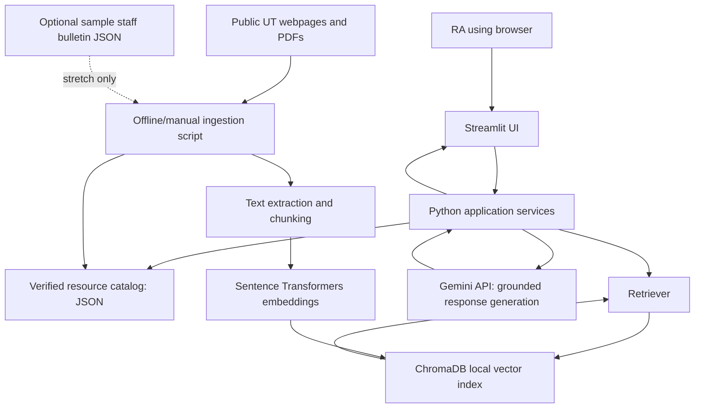

# ResLink AI — Technical Architecture

**Status:** Proposed hackathon implementation architecture. This is a design, not a claim that components are already built.

## 1. Architecture overview



**Data boundary:** Public/approved non-sensitive content and selected retrieved excerpts may be sent to Gemini for generation. Local resource data and vector index remain on the developer machine. This is **local-first, not fully offline**.

## 2. Stack

| Layer | Proposed technology | Responsibility |
|---|---|---|
| UI | Streamlit | Resource categories, chat, cards, citations, status and errors |
| Application | Python | Orchestrate catalog lookup, retrieval, generation, formatting |
| Generation | Gemini API (model to select after account/quota verification) | Produce short answers from supplied evidence |
| Vector store | ChromaDB (persistent local collection) | Semantic nearest-neighbor retrieval |
| Embeddings | Sentence Transformers (model to select/test locally) | Encode chunks and queries in the same vector space |
| PDF extraction | PyMuPDF | Extract document text and page metadata |
| Web extraction | requests + BeautifulSoup | Extract text from explicitly selected public pages |
| Structured resources | JSON | Store verified titles, categories, URLs, source metadata |
| Evaluation | pytest + JSON question set (or simple Python runner) | Verify deterministic utilities and track scenario outcomes |

**Avoid for the hackathon:** FastAPI, React, TypeScript, cloud infrastructure, login system, continuous crawling, and agentic actions.

## 3. User request flow

1. User selects a category or enters a question in Streamlit.
2. App checks the verified catalog for matching resource titles/categories/keywords and retrieves relevant document chunks from ChromaDB.
3. App assembles a bounded context containing excerpts and explicit source identifiers.
4. Gemini is instructed to answer **only** from supplied context, keep procedures concise, and acknowledge insufficient evidence.
5. App displays the answer plus citations and verified resource cards assembled **by application code**, not URLs invented by the LLM.
6. If Gemini is unavailable, show relevant retrieved sources and a clear status message rather than inventing an answer.

## 4. Ingestion pipeline

1. Manually curate publicly accessible official university URLs and PDFs; check accessibility and appropriateness.
2. Record each resource in `data/resources.json` with a stable ID, title, category, source URL, content type, and optional description/keywords.
3. Download or read allowed content on demand for ingestion; retain source URL and PDF page numbers where possible.
4. Normalize extracted text, chunk into moderately sized overlapping passages (initial chunk parameters to be tuned through tests).
5. Create embeddings using one fixed local Sentence Transformers model.
6. Upsert chunks into a persistent ChromaDB collection with stable IDs and metadata (`resource_id`, `source_url`, `title`, `page`, `chunk_index`).
7. Validate samples manually before treating the index as usable.

Do not index empty text, duplicate content blindly, or private documents. Respect site access restrictions and avoid scraping pages that disallow automated access.

## 5. Data contracts (proposed)

**Resource catalog entry** (`data/resources.json`):

```json
{
  "id": "resource-001",
  "title": "Example resource title — replace with verified title",
  "category": "reporting",
  "url": "https://example.org/replace-with-verified-source",
  "description": "Placeholder description",
  "keywords": ["weekly report"],
  "content_type": "webpage"
}
```

This is a **schema example only**. The example URL is not a UT resource and must not appear in demo results.

**Retrieved evidence:** `resource_id`, `title`, `source_url`, `page` (if available), `text`, `score` (if available).

**Response object (internal Python dict/dataclass):** `answer`, `citations`, `resources`, `status` (`grounded`, `insufficient_evidence`, or `error`).

## 6. Safety, accuracy, and privacy guardrails

- The model must never invent a URL; UI links must be selected from the curated catalog.
- Citations must map to retrieved content, not just a resource name suggested by the model.
- If evidence is missing or conflicting, state the limitation and link to the relevant official source if one is verified.
- Treat source documents as untrusted content; do not follow instructions embedded in retrieved pages.
- Never ingest private resident data, incident details, or internal staff communications without authorization.
- Keep API credentials in `.env`, exclude them from Git, and provide `.env.example` with placeholder keys only.
- The assistant is informational and must not claim authority to interpret or override university policy.

## 7. Suggested repository layout

```text
reslink-ai/
├── app.py                    # Streamlit entry point
├── AGENTS.md                 # Shared agent/project rules
├── CLAUDE.md                 # Claude Code handoff and workflow
├── README.md
├── requirements.txt
├── .env.example
├── .gitignore
├── data/
│   ├── resources.json       # Verified catalog; initially empty
│   └── documents/           # Public/authorized documents only
├── services/
│   ├── catalog.py           # Read and validate resources
│   ├── ingest.py            # Extract, chunk, embed, index
│   ├── retrieval.py         # Query and rank evidence
│   └── assistant.py         # Gemini prompt and answer orchestration
├── tests/
│   ├── test_questions.json  # Expected sources for sample questions
│   └── test_catalog.py
├── docs/
│   ├── PRD.md
│   ├── ARCHITECTURE.md
│   ├── EVALUATION.md         # Create during validation
│   └── DECISIONS.md         # Create as choices are made
└── presentation/            # Slides and demo script later
```

This is a **suggested structure**, not a requirement to create every file before writing a working vertical slice.

## 8. Development sequence and interfaces

**Milestone 1 — End-to-end vertical slice:** One verified resource → ingestion → retrieval → Gemini answer → Streamlit display → clickable verified link.

**Milestone 2 — Usable MVP:** Resource categories, more curated sources, procedural responses, provenance, robust empty/error states.

**Milestone 3 — Evaluation/demo:** Test representative queries, verify citations and URLs, prepare demonstration, document limitations.

**Milestone 4 — Stretch only:** JSON-backed staff bulletin with optional indexing and AI search. Do not start until the first three milestones are stable.

**Collaboration:** One contributor can curate/validate resources and evaluation questions while the other develops services and UI. Use separate branches or file ownership; avoid committing `.env`, `.venv`, downloaded sensitive data, or machine-specific Chroma indexes.

## 9. Known uncertainties

- Exact official UT resource URLs and their coverage have not been collected or validated.
- Gemini model availability, quota, and API access must be verified in the team's account.
- Embedding model, chunk size, retrieval top-k, and score thresholds require practical testing.
- The staff bulletin is not part of the committed MVP.
